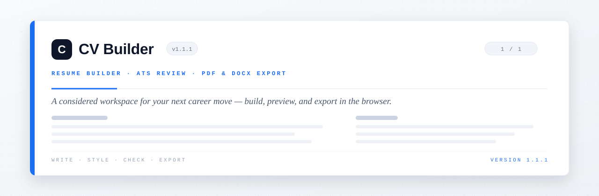

<div align="center">
  
</div>

<div align="center">

[](package.json)
[](package.json)
[](package.json)
[](package.json)
[](LICENSE)

<br />

**A considered workspace for your next career move.**

Build and refine your resume with live previews, practical ATS checks, and flexible
exports — your resume stays in your browser.

<br />

[Features](#features) · [Quick start](#quick-start) · [Guide](#using-the-builder) · [Privacy](#privacy) · [Project structure](#project-structure)

</div>

---

## At a glance

CV Builder is a responsive resume editor built with **Next.js**, **React**, **TypeScript**,
**Tailwind CSS**, and **Zustand**. Create a resume, preview it as an A4 document, review common
ATS considerations, and export a PDF or editable DOCX — all in one browser-based workspace.

Resume details and uploaded photos are saved in browser storage. PDF import and job-keyword
comparison run locally on your device.

### Tech stack

| Layer | Choice |
| --- | --- |
| Framework | Next.js 16 (App Router) · React |
| Language | TypeScript 5 |
| Styling | Tailwind CSS v4 |
| State | Zustand (with browser persistence) |
| Export | Client-side PDF (print) and DOCX generation |

---

## Features

| Capability | Description |
| --- | --- |
| **Five resume templates** | Modern, Classic, Minimal, Sidebar, and ATS-Friendly. |
| **Design controls** | Choose a font and adjust text size, spacing, bullets, and accent color. |
| **Headline styling** | Customize headline lines on Classic, Minimal, and ATS-Friendly. Modern and Sidebar keep their native heading treatment. |
| **Photo styling** | Upload an optional photo, then customize its shape and size. |
| **Live A4 preview** | See edits immediately, with page count and page-break indicators. |
| **ATS review** | Review common parsing considerations, including layout, content, and resume length. |
| **Job-keyword comparison** | Compare resume text with a job description using a local heuristic — not a guarantee of ATS results. |
| **PDF import (Beta)** | Extract text and links from text-based PDFs. Review results before replacing your resume. Scanned PDFs are not supported. |
| **PDF and DOCX export** | Save a text-selectable PDF or an editable DOCX document. |
| **Privacy-first workflow** | Resume content, photos, PDF import, and keyword comparisons stay on your device. |

---

## Quick start

### Requirements

- Node.js
- npm

### Install dependencies and start the development server

```bash
npm install
npm run dev
```

Open [http://localhost:3000](http://localhost:3000).

### Project scripts

| Command | Purpose |
| --- | --- |
| `npm run dev` | Start the local development server. |
| `npm run lint` | Run ESLint. |
| `npm run build` | Create a production build. |
| `npm run start` | Serve the production build locally. |

---

## Using the builder

1. **Enter or import your details.** PDF import is in beta and supports text-based PDFs only;
   review its results before replacing your current resume.
2. **Choose a template and refine the design.** Use the live preview to review your changes.
   Photo styling controls are available after uploading a photo.
3. **Review and export.** Use the optional ATS and keyword checks, then choose PDF or DOCX from
   the Download menu.

### PDF output

Choose **Save as PDF** in the Download menu. In the browser print dialog, select **Save as PDF**,
set the paper size to **A4**, and set margins to **None** for the intended page layout.

### DOCX output

Choose **Save as DOCX** to download an editable document compatible with Microsoft Word and other
DOCX editors.

---

## Privacy

Resume content and uploaded images are stored in browser storage on the current device. PDF import
and job-keyword comparison are processed locally in the browser. CV Builder does not send resume
content to an application backend.

---

## Deployment

Deploy on [Vercel](https://vercel.com/new) with the **Next.js** framework preset and the default
build settings. No environment variables are required for the current application.

---

## Project structure

```text
app/
  layout.tsx                 Root layout and metadata
  page.tsx                   Application entry point
  globals.css                Global styles and print rules
components/
  BuilderPage.tsx            Main editor, preview, and ATS layout
  builder/
    Topbar.tsx               Template, accent, import, and export actions
    FormPanel.tsx            Resume editor tabs
    editors.tsx              Resume section and design editors
    AtsCheckPanel.tsx        ATS review and local keyword comparison
    Preview.tsx              Live A4 preview and print rendering
    WelcomeModal.tsx         First-use guide
  resume/
    Resume.tsx               Template registry
    primitives.tsx           Shared resume elements
    templates/               Modern, Classic, Minimal, Sidebar, and ATS
lib/
  types.ts                   Resume and design types
  sample.ts                  Sample resume content
  utils.ts                   Shared utilities
  exportDocx.ts              DOCX generation
  importResumePdf.ts         Local PDF text extraction
store/
  useResumeStore.ts          Resume state and browser persistence
```

---

## Changelog

### 1.1.1

- Added template-aware design controls and headline styling.
- Improved typography resizing and applied selected fonts consistently across templates.
- Refined the Rule headline style and photo styling controls.
- Updated the welcome guide and project documentation.

### 1.1.0

- Refined the top bar, editor tabs, cards, preview, ATS panel, and welcome experience.
- Fixed the missing Certifications section in Classic.
- Centralized page-count calculations and hardened persisted-state migration.
- Improved item-list behavior and photo uploader typing.

---

## Contributing

Found a problem or have an idea? Open an issue in [GitHub Issues](https://github.com/jacobconradquendangan-portfolio/CV-Builder/issues).
Include the steps to reproduce a bug and the browser you're using.

---

## License

Released under the [MIT License](LICENSE).

<div align="center">
  <sub>Built by <strong>Jacob Conrad M. Quendangan</strong></sub>
</div>
